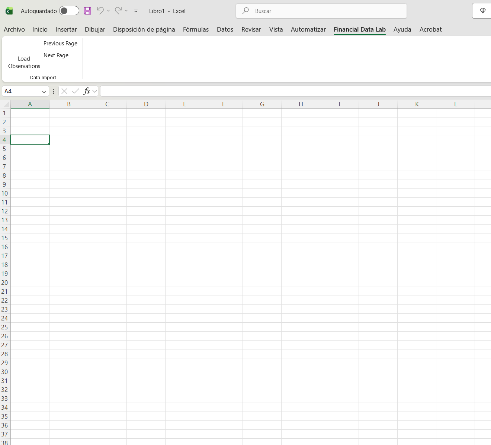
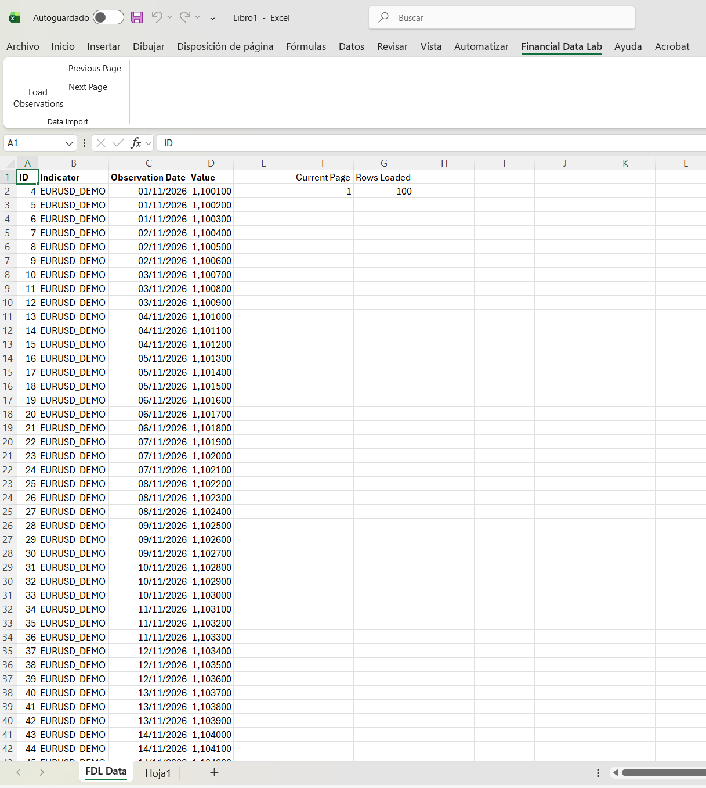
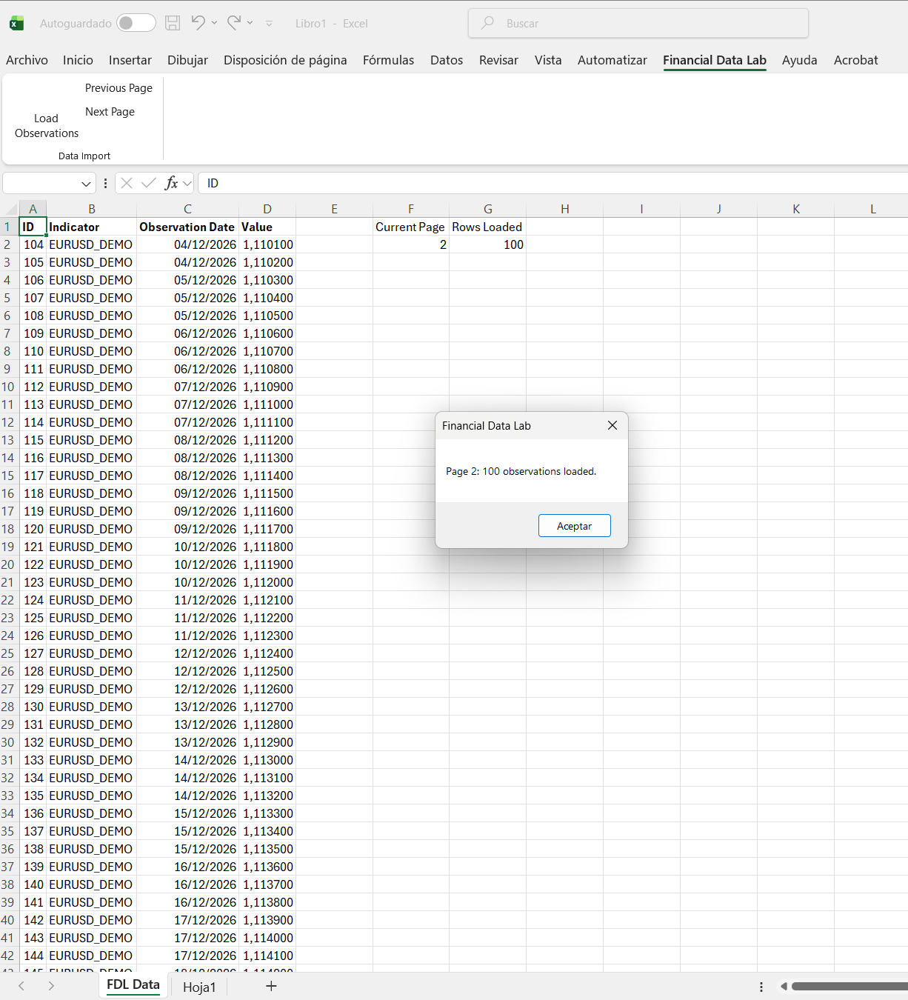

# FinancialDataLab

FinancialDataLab is a Windows desktop Excel VSTO add-in that reads financial observations from SQL Server through ADO.NET and writes them into an Excel worksheet. It is a small .NET Framework 4.8 example of separating a repository contract and calculation service from SQL access and Excel presentation code.

## Implemented features

- Excel ribbon actions to load observations and navigate to the previous or next page.
- SQL Server reads of observations by indicator and inclusive date range.
- Repository methods for full result retrieval, numbered `OFFSET/FETCH` pages, and cursor-based keyset pages.
- Excel export with column headings, date/value formatting, and current-page/row-count metadata.
- A percentage-change calculation service that rejects a zero previous value.
- xUnit unit tests for the calculation service and SQL Server integration tests for repository retrieval and paging.

The current ribbon requests the `EURUSD_DEMO` indicator for a fixed date range and uses numbered paging with a page size of 100. Keyset paging is implemented in the repository but is not connected to the ribbon. The calculation service is not currently called by the Excel workflow.

## Technology

- C# and .NET Framework 4.8
- Microsoft Excel VSTO add-in and Office interop (COM)
- SQL Server Developer container managed with Docker Compose
- ADO.NET (`System.Data.SqlClient`)
- xUnit 2.9.3 with the Visual Studio test adapter

## Solution layout

| Path | Purpose |
| --- | --- |
| `FinancialDataLab/` | VSTO host, ribbon UI, Excel exporter, and add-in configuration |
| `FinancialDataLab.Application/` | Observation model, repository interface, and calculation service |
| `FinancialDataLab.Infrastructure/` | SQL Server repository implementation |
| `FinancialDataLab.UnitTests/` | Unit tests for application behavior |
| `FinancialDataLab.IntegrationTests/` | Tests of the ADO.NET repository against a local SQL Server database |
| `database/` | Schema and sample-data scripts |
| `Docker/` | SQL Server Compose configuration and safe-to-copy environment template |
| `docs/` | Architecture, setup, testing, and implementation notes |
| `docs/images/` | Excel screenshots, with space for future documentation images |

## Local database

Prerequisites and detailed setup steps are in [docs/setup.md](docs/setup.md). In brief:

1. Install and start Docker Desktop.
2. Copy `Docker\.env.example` to `Docker\.env` and replace the placeholder with a strong local SQL Server SA password. The `.env` file is ignored by Git; do not commit it.
3. From the repository root, start the container:

   ```powershell
   docker compose --env-file Docker\.env -f Docker\compose.yaml up -d
   ```

4. Connect to `127.0.0.1,1433` from SQL Server Management Studio (SSMS) using SQL Server authentication and run the scripts in order: `database\001_create_schema.sql`, `database\002_seed_data.sql`, then `database\003_seed_pagination_data.sql`.

The scripts create the `FinancialDataLab` database and `dbo.FinancialObservations` table, add three `EURUSD` test observations, and add 300 synthetic `EURUSD_DEMO` observations used by paging tests and the add-in. See [docs/setup.md](docs/setup.md) for credential configuration and verification details.

## Configure credentials

The Compose service reads `MSSQL_SA_PASSWORD` from `Docker\.env`. The add-in separately reads `FINANCIALDATALAB_SQL_PASSWORD` from the current Windows user's environment variables. Set that user variable to the same local-only password through Windows' Environment Variables settings, then restart Excel (and Visual Studio if it is open). Integration tests read the password from `Docker\.env` themselves.

These are local-development credentials, not a production configuration. The add-in currently uses SQL Server's `sa` account and enables `TrustServerCertificate` for its localhost connection; neither choice should be copied to a production deployment. See [docs/setup.md](docs/setup.md#local-connection-configuration).

## Build and run the add-in

Use Windows with Microsoft Excel desktop and Visual Studio with the VSTO/Office development components and .NET Framework 4.8 targeting pack installed. Open `FinancialDataLab.slnx`, restore the legacy `packages.config` NuGet dependencies if prompted, select the `FinancialDataLab` VSTO project as the startup project, and build it. Configure the per-user password variable before launching Excel. Press **F5** to debug the add-in with Excel, open a workbook, then use the **Financial Data Lab** ribbon tab.

The VSTO project requires manifest signing and references a temporary `.pfx` excluded from Git, so a clean checkout may fail to build until local signing is configured. Follow [docs/setup.md](docs/setup.md#local-vsto-manifest-signing) to create or select a developer test certificate in Visual Studio. Never commit or distribute a private signing certificate.

## Run tests

Open **Test > Test Explorer** in Visual Studio and build the solution so the xUnit adapter can discover the tests. Run `FinancialDataLab.UnitTests` without SQL Server. To run `FinancialDataLab.IntegrationTests`, first start and seed the local database as described above; the integration test project expects `Docker\.env` at the solution root's `Docker` directory. The test-specific details and current limitations are in [docs/testing.md](docs/testing.md).

## Documentation and screenshots

- [Architecture](docs/architecture.md)
- [Developer setup](docs/setup.md)
- [Testing](docs/testing.md)
- [Technical notes and design decisions](docs/technical-notes.md)

The repository includes screenshots of the Excel ribbon and two exported pages:







Future screenshot placeholder: capture the local SQL Server/database setup in SSMS and save it as `docs/images/database-setup.png`.
